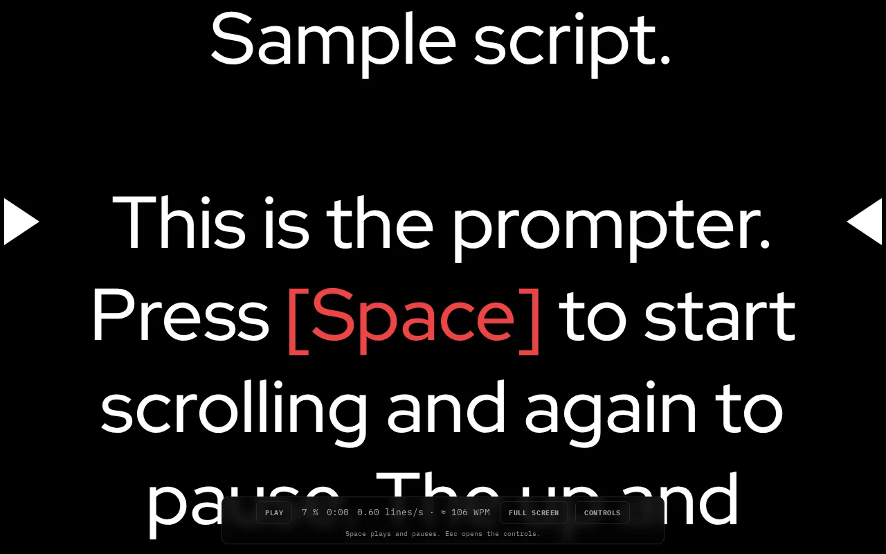

# Teleprompter

A full-screen scrolling teleprompter: load a text file or paste your script, and read it as it scrolls.

**[Open it →](https://teleprompter.carino.systems/)** — runs in your browser, nothing to install, no account.

## What it does

- Load a plain-text file or paste text; it replaces the script and starts from the top. You can also edit the text in place.
- Scrolling starts when the page opens. Play/Pause stops and resumes it, and + / − change the speed.
- A+ / A− change the text size, and Font cycles through IBM Plex Sans, Red Hat Display and IBM Plex Mono.
- Mirror flips the text horizontally, for teleprompter glass that reflects the screen.
- Marker shows an arrow for your reading line and moves it between four positions on the left and right edges.
- Anything in [square brackets] is shown in red, for cues like [pause].
- Reset goes back to the top.

The script is read from your file inside the browser and is never uploaded. Nothing is saved either, so reloading the page clears it.

## Licensing

**Mine — GNU Affero General Public License v3.0 or later.** Everything in this
repository *except* the paths listed below. Copyright © 2026 Miguel Carino.
Full terms in [LICENSE](LICENSE).

**Not mine.** The files below are third-party works redistributed here. This
project's licence does not cover them and could not: they are not mine to
relicense. Each keeps its own terms, and each carries its own notice.

| Path | What it is | Licence | Notice |
| --- | --- | --- | --- |
| [`fonts/`](fonts/) | IBM Plex Mono, IBM Plex Sans, Red Hat Display | SIL OFL 1.1 | [`fonts/OFL.txt`](fonts/OFL.txt) |

Those files travel with any fork, mirror or repackaging of this repository, and
their notices must travel with them.
